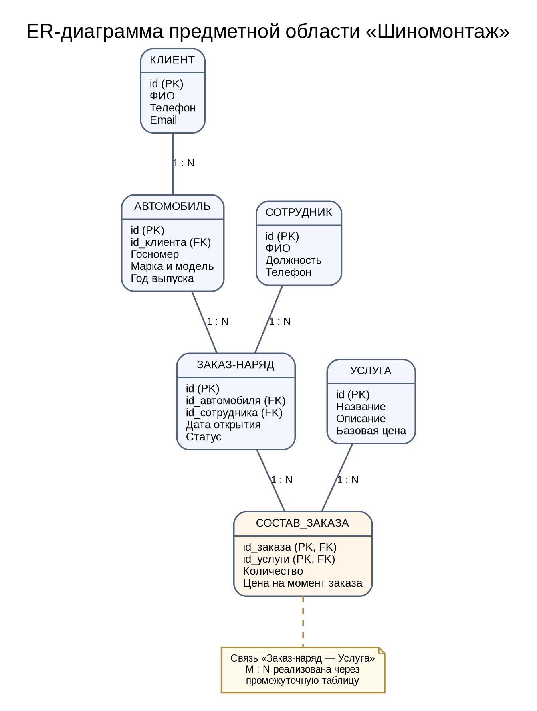

# 01. Анализ предметной области «Шиномонтаж»

**Студент:** Рулев Никита Сергеевич, 3ИП-12-24.

## 1. Выделенные сущности

В предметной области выделены пять основных сущностей, которые описывают работу шиномонтажа: клиент, автомобиль, сотрудник, услуга и заказ-наряд.

| Сущность | Атрибуты |
| --- | --- |
| **Клиент** | `id`, `ФИО`, `телефон`, `email` |
| **Автомобиль** | `id`, `id_клиента`, `госномер`, `марка_модель`, `год_выпуска` |
| **Сотрудник** | `id`, `ФИО`, `должность`, `телефон` |
| **Услуга** | `id`, `название`, `описание`, `базовая_цена` |
| **Заказ-наряд** | `id`, `id_автомобиля`, `id_сотрудника`, `дата_открытия`, `статус` |

Для реализации связи многие-ко-многим дополнительно используется техническая промежуточная таблица **Состав_заказа**: `id_заказа`, `id_услуги`, `количество`, `цена_на_момент_заказа`. Она хранит состав конкретного заказа и цену услуги на момент заказа.

## 2. Связи и их типы

| Связь | Тип | Объяснение |
| --- | --- | --- |
| Клиент — Автомобиль | 1:N | Один клиент может иметь несколько автомобилей; каждый автомобиль закреплён за одним клиентом. |
| Автомобиль — Заказ-наряд | 1:N | Для одного автомобиля может быть оформлено несколько заказов; каждый заказ относится к одному автомобилю. |
| Сотрудник — Заказ-наряд | 1:N | Один сотрудник может быть ответственным за несколько заказов; у каждого заказа в этой модели один ответственный. |
| Заказ-наряд — Услуга | M:N | В заказ входит несколько услуг, а одна услуга встречается в разных заказах. Связь реализуется через таблицу «Состав_заказа». |

Связь M:N разбивается на две связи 1:N: «Заказ-наряд — Состав_заказа» и «Услуга — Состав_заказа».

## 3. ER-диаграмма

На диаграмме прямоугольниками показаны сущности и их атрибуты; пометки PK и FK обозначают первичные и внешние ключи. Промежуточная таблица реализует связь M:N между заказами и услугами.

## 4. Почему выбраны эти сущности

- **Клиент** нужен для хранения контактных данных и связи с владельцем автомобиля.
- **Автомобиль** отделён от клиента, потому что у одного клиента может быть несколько машин, а автомобиль может приезжать на обслуживание повторно.
- **Сотрудник** позволяет фиксировать ответственного за выполнение заказа.
- **Услуга** хранит единый перечень работ и базовые цены.
- **Заказ-наряд** фиксирует факт обращения, дату и статус выполнения.
- **Состав_заказа** сохраняет перечень услуг в каждом заказе, количество и цену на момент заказа.

Выбранные сущности покрывают основные процессы шиномонтажа: учёт клиентов и автомобилей, оформление заказов, назначение ответственного сотрудника и фиксацию выполненных услуг.
