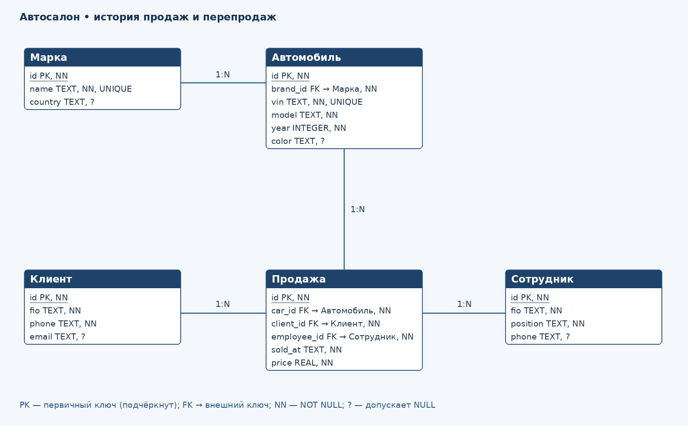
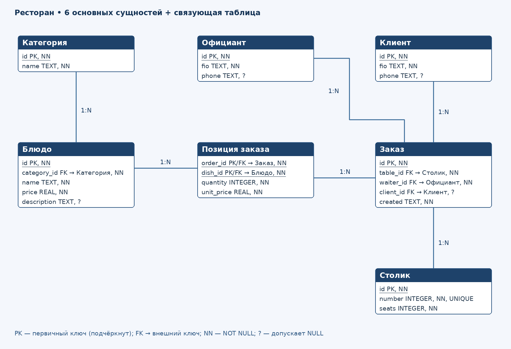

# 02. ER-диаграммы

Рулев Никита Сергеевич, 3ИП-12-24.

## 1–4. Автосалон

`autosalon.drawio` — редактируемая диаграмма для diagrams.net (draw.io), `autosalon.png` — готовое изображение той же модели. Файлы сформированы программно; для работы в draw.io выберите File → Open From → Device. PK подчёркнуты, FK помечены стрелкой. На PNG кратность указана численно; в draw.io дополнительно заданы маркеры Crow’s Foot.

| Родитель | Потомок | Связь |
| --- | --- | --- |
| Марка | Автомобиль | 1:N |
| Автомобиль | Продажа | 1:N в истории перепродаж |
| Клиент | Продажа | 1:N |
| Сотрудник | Продажа | 1:N |

Каждая продажа связана ровно с одним автомобилем, клиентом и сотрудником; у родительской записи может быть 0..N продаж.

## 5. Описание связи

Один клиент может приобрести несколько автомобилей и иметь несколько записей продажи. Каждая продажа относится к одному клиенту через client_id.

## 6. M:N

Принято явное допущение: автосалон учитывает историю продаж, включая повторный выкуп и перепродажу одного VIN. Тогда Клиент M:N Автомобиль разбивается через Продажа: Клиент 1:N Продажа и Автомобиль 1:N Продажа. Продажа хранит дату, цену и сотрудника. Это позволяет выполнить задачу без шестой сущности.

Если каждый автомобиль в системе продаётся только один раз, car_id в Продажа должен быть UNIQUE: связь Автомобиль — Продажа станет 1:0..1 и естественной связи M:N среди этих пяти сущностей уже нет. Нельзя одновременно утверждать «одна продажа на автомобиль» и рисовать его перепродажи.

## 7. Допустимость NULL

| Сущность | NOT NULL | Допускается NULL |
| --- | --- | --- |
| Марка | id, name | country |
| Автомобиль | id, brand_id, vin, model, year | color |
| Клиент | id, fio, phone | email |
| Сотрудник | id, fio, position | phone |
| Продажа | id, car_id, client_id, employee_id, sold_at, price | нет |

Для цены: CHECK(price>=0). VIN и имя марки уникальны. id задаётся как INTEGER PRIMARY KEY; при вставке без id SQLite автоматически назначает значение.

## 8*. Ресторан

`restaurant.drawio` и `restaurant.png`: шесть заданных основных сущностей и седьмая техническая сущность «Позиция заказа» для связи M:N Заказ — Блюдо.

Категория 1:N Блюдо; Столик 1:N Заказ; Официант 1:N Заказ; Клиент 1:N Заказ; Заказ 1:N Позиция заказа; Блюдо 1:N Позиция заказа. У заказа может отсутствовать зарегистрированный клиент (client_id NULL). Рассматриваются заказы в зале, поэтому table_id обязателен. В Позиция заказа составной PK(order_id,dish_id), оба поля — FK, quantity>0, unit_price>=0. Цена позиции фиксируется на момент заказа, а не вычисляется из изменяемой цены блюда. Повторение блюда объединяется в quantity.

## Поиск ошибки: парковка

Две встречные связи 1:N не являются корректной реализацией M:N. Для истории парковок нужна сущность Парковка(id PK,car_id FK,place_id FK,start_at,end_at NULL). Автомобиль 1:N Парковка и Место 1:N Парковка. Во времени одно место используют разные автомобили, автомобиль использует разные места. В один момент для обычного места допустима максимум одна активная парковка; непересечение интервалов проверяется отдельно.

## Предсказание: химчистка

В таблице Позиция будет **два FK**: order_id → Заказ.id и service_id → Услуга.id. Ссылка на клиента хранится в Заказ, дублировать её в позиции не требуется.
