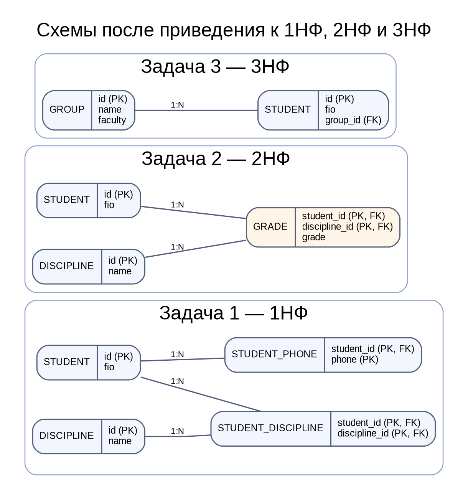

# 03. Нормализация

**Студент:** Рулев Никита Сергеевич, 3ИП-12-24.  
**СУБД:** SQLite 3.46.1. База `practice.db` содержит учебные примеры из заданий. Скрипты `01_setup.sql` и `02_tasks.sql` позволяют повторить работу с нуля; результаты запросов сохранены в `results.json`.

## 1. Приведение таблицы «Студент» к 1НФ

В исходной таблице в полях «Телефоны» и «Дисциплины» перечислено несколько значений через запятую. Это нарушает 1НФ: в одной ячейке должно храниться одно атомарное значение.

Вместо списков созданы отдельные таблицы: `nf1_student`, `nf1_student_phone`, `nf1_discipline` и `nf1_student_discipline`. Для каждого телефона и каждой дисциплины хранится отдельная строка. Промежуточная таблица сохраняет связь M:N без искусственного перемножения телефонов и дисциплин.

**Телефоны после разбиения:**

| id студента | ФИО | Телефон |
| --- | --- | --- |
| 1 | Иванов И.И. | 111-22-33 |
| 1 | Иванов И.И. | 444-55-66 |
| 2 | Петров П.П. | 555-66-77 |
| 3 | Сидоров С.С. | 888-99-00 |
| 3 | Сидоров С.С. | 123-45-67 |

**Дисциплины после разбиения:**

| Студент | Дисциплина |
| --- | --- |
| Иванов И.И. | Математика |
| Иванов И.И. | Физика |
| Петров П.П. | Математика |
| Сидоров С.С. | Химия |
| Сидоров С.С. | Биология |
| Сидоров С.С. | Физика |

## 2. Приведение таблицы «Оценка» к 2НФ

Составной первичный ключ исходной таблицы — (`id_студента`, `id_дисциплины`). Поле ФИО зависит только от `id_студента`, а название дисциплины — только от `id_дисциплины`. Это частичные зависимости от частей составного ключа, поэтому исходная таблица не соответствует 2НФ.

Данные разделены на три таблицы:
- `nf2_student(id, fio)` — сведения о студенте;
- `nf2_discipline(id, name)` — сведения о дисциплине;
- `nf2_grade(student_id, discipline_id, grade)` — оценка по паре студента и дисциплины.

После разделения неключевое поле `grade` зависит от всего составного ключа.

**Результат объединения таблиц после нормализации:**

| fio | discipline | grade |
| --- | --- | --- |
| Иванов | Математика | 5 |
| Иванов | Физика | 4 |
| Петров | Математика | 3 |
| Сидоров | Физика | 5 |

## 3. Приведение таблицы «Студент» к 3НФ

В исходной таблице факультет зависит от группы, а группа — от студента: `студент → группа → факультет`. Это транзитивная зависимость. Группа и факультет вынесены в таблицу `nf3_group(id, name, faculty)`, а в `nf3_student` хранится внешний ключ `group_id`.

**Результат:**

| id | fio | group_name | faculty |
| --- | --- | --- | --- |
| 1 | Иванов | ИС-31 | Информатики |
| 2 | Петров | ИС-31 | Информатики |
| 3 | Сидоров | ЭК-21 | Экономики |
| 4 | Кузнецов | ЭК-21 | Экономики |
| 5 | Смирнов | ИС-32 | Информатики |

## 4. Схема после задач 1–3

На диаграмме показаны отдельные схемы для трёх заданий: в 1НФ повторяющиеся списки вынесены в связанные таблицы; в 2НФ атрибуты, зависящие только от части составного ключа, вынесены из таблицы оценок; в 3НФ факультет хранится на уровне группы, а студент ссылается на группу.

## 5. Пример транзитивной зависимости

Пример, не использованный выше: таблица `Заказ(id_заказа, дата, id_клиента, город_клиента)`. Идентификатор заказа определяет клиента, а идентификатор клиента определяет город: `id_заказа → id_клиента → город_клиента`. Город зависит от клиента, а не непосредственно от заказа. Для 3НФ следует хранить `Заказ(id_заказа, дата, id_клиента)` и `Клиент(id_клиента, ФИО, город)`.

## 6. Приведение таблицы «Заказ» к 3НФ

Телефон зависит от клиента, цена — от товара, а не от отдельной строки заказа. Поэтому созданы таблицы `nf3_customer`, `nf3_order`, `nf3_product` и `nf3_order_item`. Последняя таблица связывает заказ и товар и хранит количество.

**Заказы и клиенты:**

| id | order_date | fio | phone |
| --- | --- | --- | --- |
| 1 | 01.02 | Иванов | 111 |
| 2 | 02.02 | Петров | 444 |
| 3 | 03.02 | Иванов | 111 |

**Состав заказов:**

| order_id | product | price | quantity |
| --- | --- | --- | --- |
| 1 | Хлеб | 40 | 2 |
| 1 | Молоко | 60 | 1 |
| 2 | Хлеб | 40 | 3 |
| 3 | Мыло | 80 | 1 |

## 7. Приведение таблицы «Сотрудник» к 3НФ

Руководитель отдела определяется отделом, а не отдельным сотрудником: `сотрудник → отдел → руководитель_отдела`. Поэтому создана таблица `nf3_department(id, name, manager_name)`, а в `nf3_employee` хранится `department_id`.

| fio | department | manager_name |
| --- | --- | --- |
| Иванов | Бухгалтерия | Петров |
| Сидоров | Бухгалтерия | Петров |
| Кузнецов | IT | Смирнов |
| Морозов | IT | Смирнов |

## 8. Приведение таблицы «Расписание» к 3НФ

Справочные значения групп, предметов, преподавателей и аудиторий вынесены в отдельные таблицы. Таблица `timetable_lesson` хранит день, время и внешние ключи на справочники. Составной первичный ключ — (`day`, `lesson_time`, `group_id`): он идентифицирует занятие конкретной группы в конкретное время.

В условии этого задания не указано, что преподаватель может вести только один предмет, поэтому такая функциональная зависимость не предполагается. Предмет и преподаватель хранятся в записи занятия отдельно.

| day | lesson_time | group_name | subject | teacher | room |
| --- | --- | --- | --- | --- | --- |
| Пн | 10:30 | ИС-31 | Физика | Сидоров | 202 |
| Пн | 9:00 | ИС-31 | Математика | Петров | 101 |
| Вт | 9:00 | ИС-31 | Математика | Петров | 101 |
| Вт | 9:00 | ЭК-21 | Экономика | Кузнецов | 303 |
| Ср | 9:00 | ИС-31 | Физика | Сидоров | 202 |

## Задача со звёздочкой. Приведение к BCNF

По условию каждый преподаватель ведёт только один предмет, то есть `преподаватель → предмет`. При этом у одного студента по одному предмету один преподаватель. В исходной таблице преподаватель не является суперключом, поэтому зависимость нарушает BCNF. Выполнена декомпозиция на `bcnf_student_subject(student, subject)` и `bcnf_teacher_subject(teacher, subject)`.

**Студенты и предметы:**

| student | subject |
| --- | --- |
| Иванов | Математика |
| Иванов | Физика |
| Петров | Математика |
| Сидоров | Физика |

**Преподаватели и предметы:**

| teacher | subject |
| --- | --- |
| Петров | Математика |
| Сидоров | Физика |

## Задача на поиск ошибки

Таблица `Студент(id, ФИО, телефон1, телефон2)` содержит повторяющуюся группу однотипных столбцов для телефонов. Даже если в каждой ячейке записан один телефон, структура не масштабируется и нарушает требование об отсутствии повторяющихся групп. Правильнее вынести телефоны в отдельную таблицу `StudentPhone(student_id, phone)`: одна строка — один телефон.

## Задача на предсказание результата

Если автора вынести в отдельную таблицу `Автор(id, ФИО, ...)`, а в таблице `Книга` оставить `author_id`, структура приближается к 3НФ: сведения об авторе хранятся один раз и зависят от ключа автора, а не повторяются в каждой книге. Для строгой проверки 3НФ нужно также убедиться, что в таблице книги нет других транзитивных зависимостей.

## Итог

В работе показаны атомарность значений (1НФ), устранение частичных зависимостей от составного ключа (2НФ), устранение транзитивных зависимостей (3НФ) и дополнительная декомпозиция BCNF. Ссылочная целостность и первичные ключи проверены; все запросы из `02_tasks.sql` воспроизводятся.
