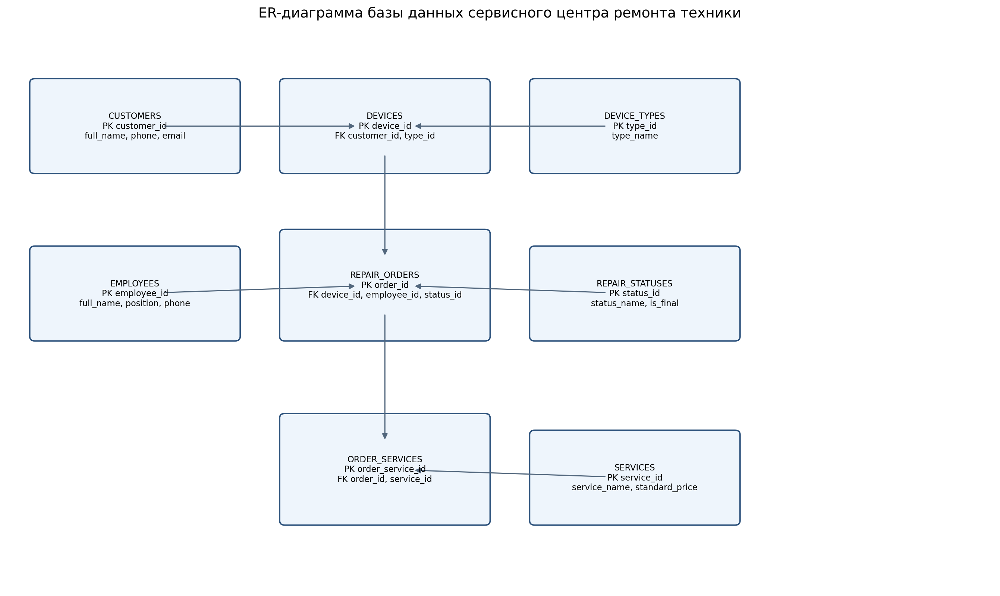

# Индивидуальное задание и практические работы по базам данных

**Студент:** Рулев Никита Сергеевич  
**Группа:** 3ИП-12-24  
**Дисциплина:** «Разработка, администрирование и защита баз данных»  
**Основная предметная область:** сервисный центр по ремонту техники  
**СУБД:** SQLite

## О проекте

Репозиторий объединяет две части учебной работы:

1. **14 практических работ** по проектированию реляционных баз данных, SQL, нормализации, ограничениям целостности, импорту данных, соединению таблиц и индексам.
2. **Индивидуальный проект** — спроектированная и заполненная база данных сервисного центра по ремонту техники.

В проект входят исходные условия заданий в PDF, отчёты с решениями, SQL-скрипты, готовые базы SQLite, тестовые CSV-файлы, результаты запросов в JSON, ER-диаграммы, а также итоговый отчёт и дневник практики.

## Состав репозитория

| Путь | Содержимое |
| --- | --- |
| `01_practice/` | Материалы 14 практических работ: PDF заданий, отчёты, SQL, базы SQLite, CSV, JSON и диаграммы |
| `02_individual/` | Итоговый проект базы данных сервисного центра |
| `import_data.py` | Создание итоговой базы и импорт данных из CSV |
| `verify_practice.py` | Проверка учебных баз, внешних ключей, повторное выполнение SQL в памяти и проверка диаграмм |
| `practice_validation.json` | Сохранённый отчёт о проверке практических работ |
| `validation_results.json` | Сводка проверки итоговой базы сервисного центра |
| `README.md` | Описание проекта и инструкция по запуску |

## 1. Индивидуальный проект: база данных сервисного центра

### Назначение

База данных предназначена для учёта клиентов и принадлежащих им устройств, регистрации обращений на ремонт, назначения мастеров, отслеживания статусов заказ-нарядов и учёта услуг, выполненных в рамках каждого заказа.

### Структура базы данных

В проекте реализованы восемь связанных таблиц.

| Таблица | Назначение | Основные поля |
| --- | --- | --- |
| `customers` | Клиенты сервисного центра | `customer_id` (PK), `full_name`, `phone`, `email`, `created_at` |
| `device_types` | Справочник типов устройств | `type_id` (PK), `type_name` |
| `devices` | Устройства клиентов | `device_id` (PK), `customer_id` (FK), `type_id` (FK), `brand`, `model`, `serial_number`, `purchase_date` |
| `employees` | Сотрудники и мастера | `employee_id` (PK), `full_name`, `position`, `phone` |
| `repair_statuses` | Справочник статусов ремонта | `status_id` (PK), `status_name`, `is_final` |
| `repair_orders` | Заказ-наряды на ремонт | `order_id` (PK), `device_id` (FK), `employee_id` (FK), `status_id` (FK), `received_at`, `planned_completion_at`, `completed_at`, `issue_description`, `diagnosis`, `notes` |
| `services` | Справочник услуг и стандартных цен | `service_id` (PK), `service_name`, `standard_price` |
| `order_services` | Услуги, включённые в заказ | `order_service_id` (PK), `order_id` (FK), `service_id` (FK), `quantity`, `unit_price` |

**PK** — первичный ключ, **FK** — внешний ключ.

### Связи между таблицами

- Один клиент может иметь несколько устройств: `customers` → `devices` (1:N).
- Один тип устройства может быть указан у многих устройств: `device_types` → `devices` (1:N).
- Для одного устройства может быть оформлено несколько заказ-нарядов: `devices` → `repair_orders` (1:N).
- Один сотрудник может отвечать за несколько заказов: `employees` → `repair_orders` (1:N).
- Один статус может использоваться во многих заказах: `repair_statuses` → `repair_orders` (1:N).
- Один заказ может включать несколько услуг, а одна услуга может встречаться в разных заказах. Связь M:N реализована через `order_services`.

В таблице `order_services` хранится цена услуги на момент оформления заказа. Поэтому изменение стандартной цены в справочнике `services` не меняет стоимость уже оформленных заказов.

### ER-диаграмма



Исходное описание диаграммы: [`er_diagram.mmd`](02_individual/docs/er_diagram.mmd).

### Наполнение тестовыми данными

В готовой базе находятся следующие записи:

| Таблица | Количество записей |
| --- | ---: |
| `customers` | 9 |
| `device_types` | 5 |
| `devices` | 12 |
| `employees` | 4 |
| `repair_statuses` | 5 |
| `repair_orders` | 12 |
| `services` | 8 |
| `order_services` | 17 |

Всего подготовлено 72 записи в восьми таблицах.

### Ограничения целостности

В SQL-схеме используются:

- `PRIMARY KEY` — первичные ключи таблиц;
- `FOREIGN KEY` — связи между таблицами;
- `NOT NULL` — обязательные поля;
- `UNIQUE` — уникальные телефоны, email, серийные номера и названия справочников;
- `CHECK` — проверка допустимых значений и дат;
- `DEFAULT` — значения по умолчанию;
- `ON DELETE CASCADE` для строк услуг при удалении связанного заказ-наряда.

Для контроля ссылочной целостности включается `PRAGMA foreign_keys = ON`.

### Индексы итогового проекта

Созданы два индекса:

| Индекс | Поля | Назначение |
| --- | --- | --- |
| `idx_repair_orders_status_received` | `repair_orders(status_id, received_at)` | Ускорение поиска заказов по статусу и дате приёмки |
| `idx_devices_customer_id` | `devices(customer_id)` | Ускорение поиска устройств конкретного клиента |

### SQL-запросы итогового проекта

Файл [`02_individual/sql/03_queries.sql`](02_individual/sql/03_queries.sql) содержит 15 запросов:

1. Вывод всех заказ-нарядов от новых к старым.
2. Вывод заказов вместе с клиентом, устройством, мастером и статусом (`JOIN`).
3. Поиск заказов, которые ещё не завершены.
4. Подсчёт заказов по каждому статусу.
5. Расчёт выручки по каждому виду услуг.
6. Подсчёт количества обращений каждого клиента.
7. Расчёт стоимости работ по каждому заказу.
8. Расчёт средней стоимости заказа.
9. Подсчёт заказов, назначенных каждому мастеру.
10. Поиск заказов дороже средней стоимости.
11. Поиск клиентов, у которых ещё не было ремонтов (`NOT EXISTS`).
12. Поиск устройств, которые ещё не поступали в ремонт.
13. Вывод пяти последних поступивших устройств.
14. Поиск услуг со стоимостью выше средней цены справочника.
15. Подсчёт устройств каждого типа.

### Файлы индивидуального проекта

```text
02_individual/
├── repair_service.db
├── csv/
│   ├── customers.csv
│   ├── device_types.csv
│   ├── employees.csv
│   ├── repair_statuses.csv
│   ├── services.csv
│   ├── devices.csv
│   ├── data.csv
│   └── order_services.csv
├── docs/
│   ├── otchet.docx
│   ├── dnevnik.docx
│   ├── er_diagram.png
│   └── er_diagram.mmd
├── screenshots/
│   ├── 01_db_created.png
│   ├── 02_tables.png
│   ├── 03_import.png
│   ├── 04_queries.png
│   └── README.md
└── sql/
    ├── 01_create_tables.sql
    ├── 02_indexes.sql
    └── 03_queries.sql
```

Назначение CSV-файлов:

| CSV-файл | Таблица назначения |
| --- | --- |
| `customers.csv` | `customers` |
| `device_types.csv` | `device_types` |
| `employees.csv` | `employees` |
| `repair_statuses.csv` | `repair_statuses` |
| `services.csv` | `services` |
| `devices.csv` | `devices` |
| `data.csv` | `repair_orders` |
| `order_services.csv` | `order_services` |

В `docs/otchet.docx` находится итоговый отчёт по индивидуальному заданию. В `docs/dnevnik.docx` находится проект дневника практики: фактические даты и подписи необходимо заполнить и согласовать с руководителем.

**Примечание о контрольных изображениях:** PNG в `02_individual/screenshots/` сформированы по результатам выполнения базы и SQL-запросов. Это иллюстрации результатов, а не снимки интерфейса DB Browser for SQLite. Если преподаватель требует именно скриншоты программы, их нужно сделать самостоятельно и заменить или дополнить имеющиеся изображения.

## 2. Практические работы

В архив включены 14 PDF-методичек и материалы к каждой работе. В папках с SQL-практиками обычно находятся `01_setup.sql` для создания структуры и тестовых данных, `02_tasks.sql` с заданиями, `practice.db` с готовой базой, `results.json` с результатами запросов и `otchet.md` с решением и пояснениями.

| № | Папка | Что выполнено |
| ---: | --- | --- |
| 01 | `01_Анализ_предметной_области/` | Анализ предметной области «Шиномонтаж»: выделение сущностей, атрибутов, связей 1:N и M:N; ER-диаграмма в PNG и исходнике DOT. |
| 02 | `02_ER_диаграмма/` | ER-модели автосалона и ресторана; изображения PNG и редактируемые диаграммы `.drawio`; разбор ключей, связей, NULL и M:N. |
| 03 | `03_Нормализация/` | Приведение данных к 1НФ, 2НФ и 3НФ, разбор функциональных зависимостей, дополнительная декомпозиция BCNF; схема нормализации, SQL и проверки. |
| 04 | `04_Создание_БД/` | Основы SQLite: создание и заполнение таблиц студентов и преподавателей, фильтрация преподавателей по стажу, хранение BLOB и значения даты по умолчанию. |
| 05 | `05_Создание_таблиц/` | Создание связанных таблиц категорий, товаров, поставщиков и поставок; применение `PRIMARY KEY`, `FOREIGN KEY`, `NOT NULL`, `UNIQUE`, `CHECK`, `DEFAULT`; автоматические проверки ограничений. |
| 06 | `06_Ограничения/06_Изменение_структуры/` | Изменение структуры таблиц с помощью `ALTER TABLE`: добавление столбца, переименование поля и проверка результата. |
| 07 | `07_Импорт_данных/` | Импорт CSV в SQLite, работа с временными таблицами, очистка строк, преобразование типов и дат, поиск некорректных и пустых значений. |
| 08 | `06_Ограничения/08_Ссылочная_целостность/` | Внешние ключи и ссылочная целостность; проверка `CASCADE`, `RESTRICT`, `SET NULL` и связей M:N. Есть Python-скрипт для запуска тестов. |
| 09 | `09_Фильтрация_и_сортировка/` | Запросы `SELECT`, фильтрация через `WHERE`, `BETWEEN`, `LIKE`, сортировка и ограничение количества строк. |
| 10 | `10_Агрегатные_функции/` | Использование `COUNT`, `SUM`, `AVG`, `MIN`, `MAX`, группировка данных и агрегатные вычисления. |
| 11 | `11_JOIN/` | Соединение таблиц с помощью `INNER JOIN`, `LEFT JOIN`, `RIGHT JOIN`, `FULL OUTER JOIN`, `SELF JOIN`; объединение данных из нескольких таблиц. |
| 12 | `12_Подзапросы/` | Скалярные и коррелированные подзапросы, `IN`, `EXISTS`, `NOT EXISTS`, сравнение со средними и максимальными значениями, CTE. |
| 13 | `13_Индексы/` | Создание одиночных и составных индексов, анализ `EXPLAIN QUERY PLAN`, замер производительности на тестовом наборе данных. |
| 14 | `14_Ограничения_и_CASE/` | Ограничения `CHECK`, `UNIQUE`, `DEFAULT`; условные выражения `CASE`, обработка NULL через `COALESCE` и `NULLIF`, проверка ограничений. |

### Особенности расположения отдельных работ

- Работа № 06 находится внутри `06_Ограничения/06_Изменение_структуры/`.
- Работа № 08 находится внутри `06_Ограничения/08_Ссылочная_целостность/`. Общий файл `06_Ограничения/otchet.md` объясняет расположение обеих работ.
- Папка `08_SELECT_запросы/` содержит короткую навигационную заметку. Полное решение по `SELECT`, фильтрации и сортировке находится в `09_Фильтрация_и_сортировка/`, поскольку соответствующая методичка объединяет эти темы.
- В работе № 02 находятся две диаграммы: автосалона и ресторана. Файлы `.drawio` можно редактировать в [diagrams.net](https://app.diagrams.net/).

## 3. Как открыть материалы

- **Отчёты:** откройте нужный `otchet.md` в VS Code или GitHub. В VS Code предпросмотр Markdown открывается сочетанием `Ctrl+Shift+V`.
- **PDF-условия:** файлы `zadanie.pdf` лежат в папках соответствующих практических работ.
- **Базы данных:** откройте `practice.db` или `02_individual/repair_service.db` в DB Browser for SQLite либо другой программе для SQLite.
- **SQL:** откройте `.sql` в VS Code или выполните в SQLite. Для повторного выполнения практической работы используйте новую пустую базу и запускайте `01_setup.sql`, затем `02_tasks.sql`.
- **ER-диаграммы:** PNG можно просматривать как изображения; `.drawio` открываются в diagrams.net; `.mmd` — исходник Mermaid-диаграммы.
- **Документы:** итоговый отчёт и дневник находятся в `02_individual/docs/`.

Не запускайте `02_tasks.sql` повторно поверх уже заполненной базы без предварительной подготовки: некоторые задания создают таблицы, изменяют структуру или вставляют тестовые записи.

## 4. Запуск и пересоздание итоговой базы

Требуется Python 3. Дополнительные Python-библиотеки для основного импорта не нужны: используются стандартные модули `csv`, `sqlite3` и `pathlib`.

Из корневой папки репозитория выполните:

```bash
python import_data.py
```

Скрипт:

1. удаляет существующий файл `02_individual/repair_service.db`, если он есть;
2. создаёт новую SQLite-базу;
3. выполняет `02_individual/sql/01_create_tables.sql`;
4. импортирует восемь CSV-файлов в соответствующие таблицы;
5. создаёт индексы из `02_individual/sql/02_indexes.sql`;
6. сохраняет изменения и выводит список созданных таблиц.

**Важно:** повторный запуск `python import_data.py` полностью пересоздаёт `repair_service.db`. Если в базе появились собственные изменения, сначала сохраните её копию.

## 5. Проверка практических работ

Из корневой папки репозитория можно запустить:

```bash
python verify_practice.py
```

Скрипт выполняет проверки в режиме чтения:

- проверяет целостность включённых баз SQLite через `PRAGMA integrity_check`;
- проверяет отсутствие нарушений внешних ключей через `PRAGMA foreign_key_check`;
- повторно выполняет SQL-запросы в базе в памяти и сравнивает результаты с `results.json`;
- проверяет структуру XML у редактируемых диаграмм `.drawio`.

В запросах, использующих `CURRENT_DATE` или `date('now')`, дата закономерно меняется при повторном запуске. Проверка учитывает это и контролирует формат таких дат, не требуя совпадения с датой сохранённого результата.

Дополнительные скрипты в папках практик:

- `07_Импорт_данных/import_csv.py` — повторный импорт учебных CSV в базу этой практической работы;
- `06_Ограничения/08_Ссылочная_целостность/run.py` — запуск тестов ссылочной целостности;
- `05_Создание_таблиц/verify_constraints.py` — проверка ограничений таблиц;
- `03_Нормализация/verify_constraints.py` и `14_Ограничения_и_CASE/verify_constraints.py` — дополнительные проверки ограничений;
- `13_Индексы/benchmark.py` — повторный замер производительности индексов. Время выполнения зависит от компьютера и окружения.

## 6. Контрольные результаты и состав архива

В архиве находятся:

- 14 PDF-файлов с условиями практических работ;
- 13 баз SQLite: 12 учебных баз и итоговая база сервисного центра;
- 27 SQL-файлов;
- 13 CSV-файлов;
- 17 JSON-файлов с результатами и проверками;
- 9 PNG-изображений;
- 2 редактируемые диаграммы `.drawio`;
- итоговый отчёт и дневник практики в формате DOCX.

По сохранённой проверке итоговой базы успешно выполнены все 15 SQL-запросов; нарушений внешних ключей не обнаружено, оба индекса созданы.

Файл `validation_results.json` содержит количество записей в каждой из восьми таблиц, статус выполнения запросов, результат проверки внешних ключей и список индексов.

Последняя проверка практических работ завершилась успешно: проверены 12 баз SQLite, повторно выполнены 10 наборов SQL-запросов в памяти, проверены две диаграммы `.drawio`. Результат сохранён в `practice_validation.json`. Для получения актуального результата после распаковки запустите `python verify_practice.py`.
